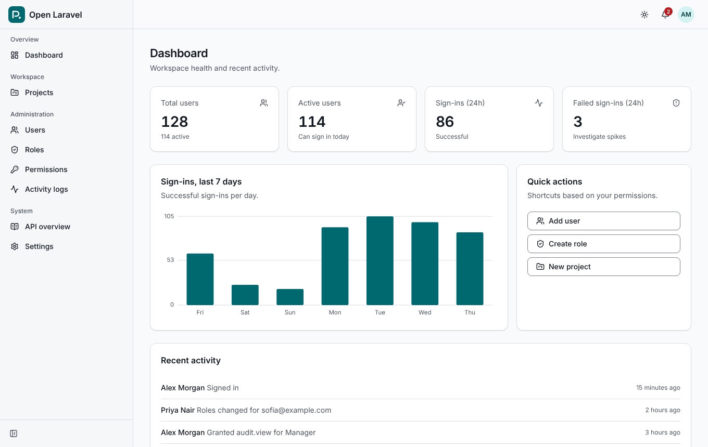
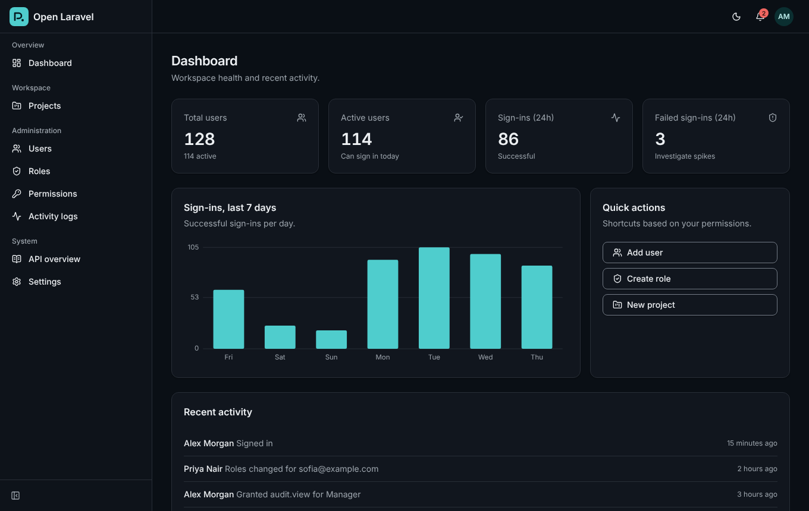
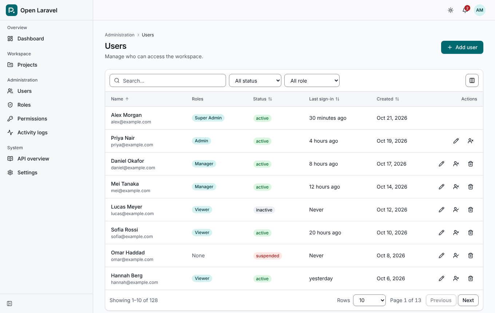
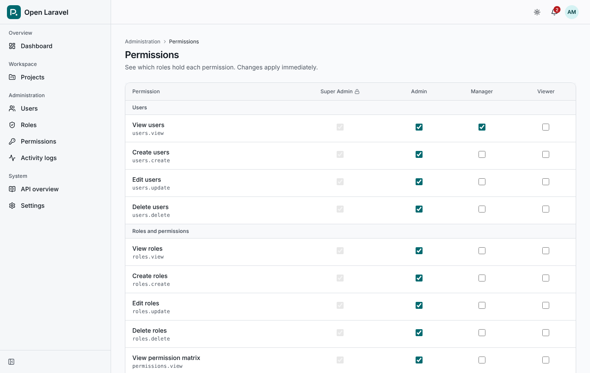
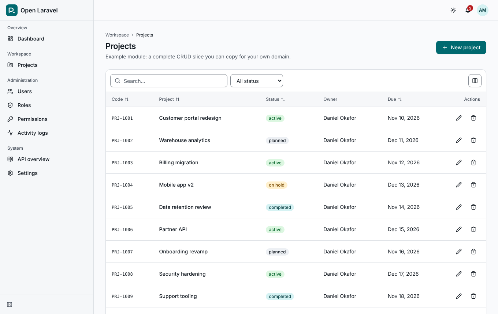
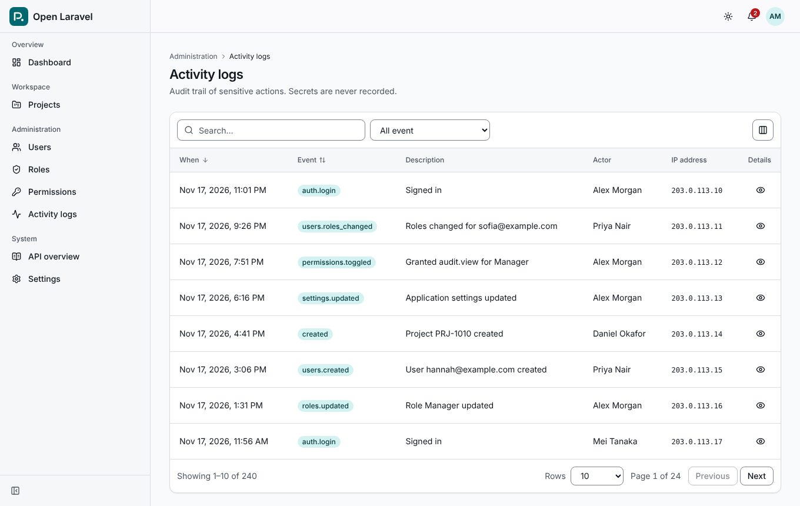
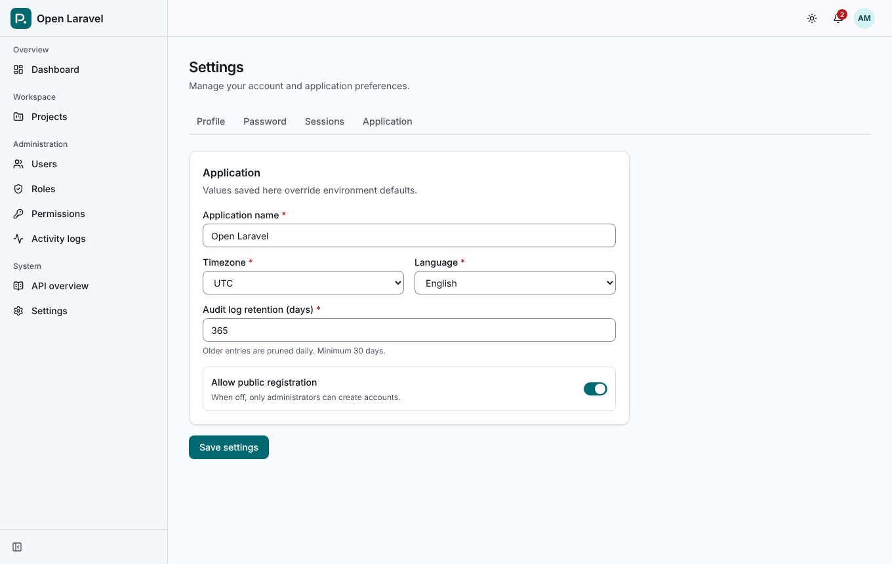
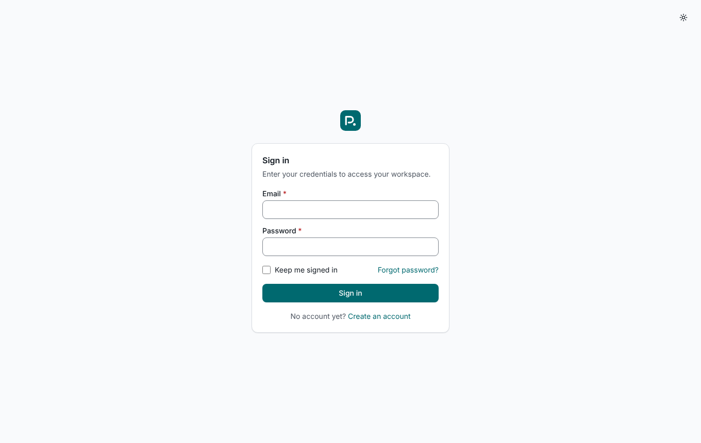

# Open Laravel

Enterprise-ready Laravel application template: **modular monolith**, **RBAC**, **audit trail**, runtime **settings**, **notifications**, a **versioned API** and an accessible **design system** (light, dark and system themes).

Laravel 13 · PHP 8.3+ · Inertia 3 · React 19 · TypeScript · Tailwind 4 · Vite 8

[](https://github.com/robotjaol/open-laravel/actions/workflows/php.yml)
[](https://github.com/robotjaol/open-laravel/actions/workflows/frontend.yml)
[](https://github.com/robotjaol/open-laravel/actions/workflows/security.yml)

## Preview

**Live, clickable demo (no backend, sample data, changes are not saved): https://robotjaol.github.io/open-laravel/**

The demo renders the real pages and layouts with a mocked data layer ([ADR 0007](research/adr/0007-static-preview.md)). Run it locally in two commands:

```bash
npm install && npm run build:preview
python3 -m http.server 4173 -d docs/preview     # open http://localhost:4173
```

| | |
|---|---|
| <br>**Dashboard** (light) | <br>**Dashboard** (dark) |
| <br>**User management** | <br>**Permission matrix** |
| <br>**Projects** (example module) | <br>**Activity log** |
| <br>**Application settings** | <br>**Sign in** |

Screenshots are generated by `npm run build:preview && npm run preview:screenshots`.

## What is included

| Area | Details |
|---|---|
| Authentication | Sign in, optional registration, password reset, optional email verification, login history, rate limiting, deactivated accounts cut off on next request |
| Authorization | Roles, permission registry, permission matrix, policies, locked Super Admin, last-admin protection |
| Audit | Immutable, redacted audit log with activity page and retention command |
| Settings | App name, timezone, locale, registration toggle, audit retention (DB over config defaults) |
| API | `/api/v1`, Sanctum bearer tokens, uniform error envelope, OpenAPI spec |
| Modules | Auto-discovered; example `Projects` module (web + API + policy + migration); `php artisan module:make` |
| UI | 14 required pages, server-driven tables, light/dark/system themes, WCAG 2.2 AA-oriented tokens and contrast test |
| Quality | PHPUnit (unit, feature, integration, architecture), Vitest, Playwright E2E, Larastan, Pint, ESLint, Prettier |
| Delivery | Docker (nginx + PHP-FPM, non-root), Compose with PostgreSQL, GitHub Actions |

## Quick start

```bash
composer install && npm install
cp .env.example .env && php artisan key:generate
touch database/database.sqlite && php artisan migrate --seed
composer dev
```

Local-only seed login: `admin@example.com` / `ChangeMe-Local-Only-123!` (from `.env.example`; never use outside your machine). Details: [docs/getting-started.md](docs/getting-started.md).

## Project structure

```
app/Core/          Authentication, Authorization, Audit, Settings, Notifications
app/Modules/       Dashboard, Users, Roles, Projects (example) - auto-discovered
app/Shared/        Table query, pagination, base controller, helpers
resources/js/      Inertia pages, layouts, components, design tokens, preview fixtures
tests/             Unit, Feature, Integration, Architecture, Browser (Playwright), js (Vitest)
docs/              Documentation set, reports, screenshots
research/          Research dossier, source register, ADRs
```

## Documentation

[Architecture](docs/architecture.md) · [Getting started](docs/getting-started.md) · [Module guide](docs/module-guide.md) · [Auth and RBAC](docs/authentication-authorization.md) · [API](docs/api.md) ([OpenAPI](docs/openapi.yaml)) · [Design system](docs/design-system.md) · [Accessibility](docs/accessibility.md) · [Security](docs/security.md) · [Threat model](docs/threat-model.md) · [Testing](docs/testing.md) · [Deployment](docs/deployment.md) · [Configuration](docs/configuration.md) · [Operations](docs/operations.md) · [Troubleshooting](docs/troubleshooting.md) · [Roadmap and limitations](docs/roadmap.md) · [Implementation status](docs/reports/implementation-status.md) · [Research](research/README.md)

## Status and honesty notes

See [docs/reports/implementation-status.md](docs/reports/implementation-status.md) for what is verified, what is not, and known limitations. In short: frontend checks (lint, format, types, 44 unit/component tests including contrast) were executed locally; backend verification runs in GitHub Actions because PHP dependencies could not be installed in the authoring environment.

## Contributing, security, license

[CONTRIBUTING.md](CONTRIBUTING.md) · [SECURITY.md](SECURITY.md) · [CHANGELOG.md](CHANGELOG.md) · [MIT License](LICENSE)
